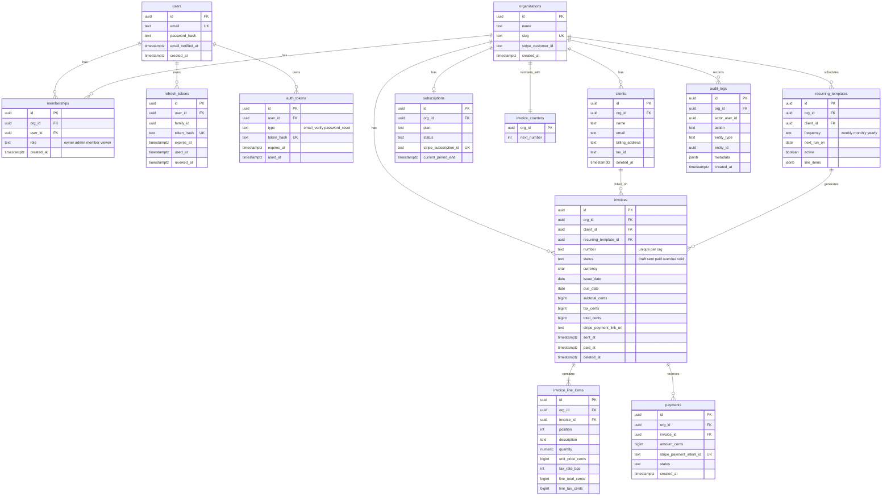

# Data model

Companion to ADR-0001 (tenancy), ADR-0002 (auth) and ADR-0003 (ORM).

## ERD

Not in the diagram: `webhook_events` (`stripe_event_id` primary key, `type`,
`processed_at`). It is global, has no tenant, and exists only for webhook
idempotency.

## Conventions

- Primary keys are UUIDs, so ids are not guessable and not enumerable.
- Every tenant-owned table has `org_id uuid not null` and an index that starts
  with `org_id`.
- `created_at` and `updated_at` on mutable tables, in UTC (`timestamptz`).
- Soft delete (`deleted_at`) for `clients` and `invoices`. Queries filter it by
  default. Hard deletes are limited to a future retention job.
- `audit_logs` is append-only: the app role gets INSERT and SELECT only.

## RLS coverage

| Table | RLS | Why |
|---|---|---|
| clients, invoices, invoice_line_items, payments, subscriptions, invoice_counters, recurring_templates, audit_logs | Yes, by `org_id` | Tenant-owned data |
| memberships | Yes, by `org_id`, plus a narrow read policy by user id | Login must list a user's organizations before any tenant is chosen |
| organizations | Yes, visible only if the user has a membership | Same reason |
| users, refresh_tokens, auth_tokens, webhook_events | No | Not tenant-owned. Protected by the application layer and column rules |

## Money rules

- All amounts are integer minor units (cents) in `bigint`. No floats.
- One currency per invoice, default USD, assumed to have 2 decimal places.
- `quantity` is `numeric(12,4)`. `tax_rate_bps` is an integer in basis points
  (825 means 8.25 percent).
- Per line: `line_total = round(quantity * unit_price)`, then
  `line_tax = round(line_total * tax_rate_bps / 10000)`, rounding half up.
- Invoice totals are the sums of the rounded line values, so the printed numbers
  always add up exactly.
- Totals are stored (not recomputed on read) so an issued invoice never changes
  if rules change later.

## Invoice numbering

- Format `INV-000001`, unique per organization, via `unique (org_id, number)`.
- The number is assigned when a draft is first sent, not on creation, so
  abandoned drafts leave no gaps.
- Assignment locks the org's `invoice_counters` row
  (`select ... for update`), increments it, and uses the value, all in one
  transaction. Concurrent sends cannot produce duplicates.

## Invoice lifecycle

`draft -> sent -> paid`, `sent -> overdue` (set by a daily job), and
`draft|sent|overdue -> void`. Once an invoice leaves `draft`, its lines, amounts
and number are immutable. Corrections are done by voiding and reissuing.
